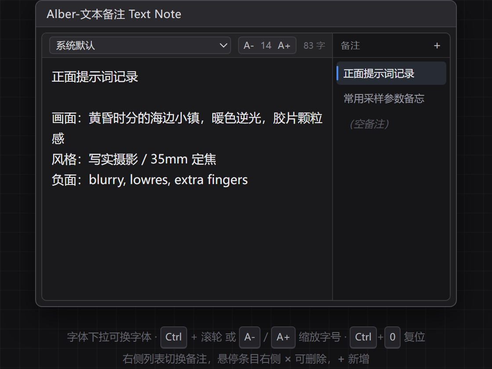

# Alber-ComfyUI-TextNote

> 给ComfyUI用的多标签文本备注节点 —— 左侧写内容、右侧管列表，字号随手缩放，字体随便换。



---

## ✨ 功能特性

| | |
| --- | --- |
| **左内容 · 右列表** | 左侧是编辑区，右侧是备注列表；点条目即切换，`+` 新增，悬停条目右侧 `×` 删除 |
| **字号自由缩放** | 工具条 `A-` / `A+` 逐级缩放（9–48）；内容区 `Ctrl + 滚轮` 快速缩放；`Ctrl + 0` 复位 |
| **字体自由设置** | 内置系统默认、微软雅黑、黑体、宋体、楷体、仿宋、等宽、衬线共 8 种字体 |
| **每条备注独立记账** | 字号与字体分别存在各自的备注里，切换列表互不影响 |
| **随工作流保存** | 内容存进节点的隐藏 widget，保存 / 加载工作流后原样恢复，换机器也不丢 |
| **纯 UI 节点** | 不产生任何计算输出，不参与出图流程，随便放画布哪里都行 |
| **零依赖** | 不引入任何第三方 Python 包，也不需要 `pip install` |

## 📦 安装

### 方式一：ComfyUI Manager（推荐）

在 Manager 里搜索 `Alber Text Note` 安装，装完重启 ComfyUI。

### 方式二：手动 clone

```bash
cd ComfyUI/custom_nodes
git clone https://github.com/jiyaxi2003-jzl/Alber-ComfyUI-TextNote.git
```

### 方式三：下载压缩包

下载仓库 ZIP，解压后把**整个文件夹**放进 `ComfyUI/custom_nodes/`：

```
ComfyUI/
└── custom_nodes/
    └── Alber-ComfyUI-TextNote/
        ├── __init__.py
        ├── nodes.py
        ├── pyproject.toml
        └── web/
            ├── alber_note_panel.js
            └── alber_text_note.js
```

装好后**重启 ComfyUI** 并强制刷新浏览器（`Ctrl + F5`，前端文件有缓存）。

节点位置：画布右键 → `Alber/备注` → **Alber-文本备注 Text Note**

## 🖱 使用说明

界面分左右两块：**左边是内容，右边是列表**。

| 操作 | 效果 |
| --- | --- |
| 点击右侧列表条目 | 切换到该条备注 |
| 右侧 `+` | 新建一条备注并自动选中 |
| 悬停条目 → `×` | 删除该条备注（删光会自动留一条空备注） |
| `A-` / `A+` | 字号 −1 / +1，范围 9–48 |
| `Ctrl + 滚轮` | 在内容区快速缩放字号 |
| `Ctrl` + `=` / `-` / `0` | 放大 / 缩小 / 复位字号 |
| 拖动节点右下角 | 面板高度跟着节点一起变高 |
| 拖动节点左右边框 | 左右两块按比例分配宽度 |

列表条目的标题会自动取该备注的**第一行非空文本**，最多显示 24 字，空了就显示「（空备注）」。

## 💾 数据存储

备注数据以 JSON 字符串形式保存在节点里隐藏的 widget `alber_note_data` 中，随工作流一起序列化：

```json
{
  "activeId": "n1a2b3c",
  "items": [
    {
      "id": "n1a2b3c",
      "text": "正面提示词记录\n\n画面：黄昏时分的海边小镇……",
      "fontSize": 14,
      "fontFamily": "system-ui, -apple-system, ..."
    }
  ]
}
```

这意味着：只要工作流 JSON 还在，备注内容就不会丢。想备份备注，直接存一份工作流即可。

## 🗂 目录结构

```
Alber-ComfyUI-TextNote/
├── __init__.py              # 插件入口，声明 WEB_DIRECTORY
├── nodes.py                 # 后端节点定义（纯 UI 节点）
├── pyproject.toml           # 包信息 + Comfy Registry 发布配置
├── web/
│   ├── alber_note_panel.js  # 面板组件（不依赖 ComfyUI，可独立预览）
│   └── alber_text_note.js   # ComfyUI 扩展注册与节点生命周期钩子
├── preview.html             # 纯浏览器效果预览（不参与 ComfyUI 加载）
├── preview.png              # 效果截图
├── CHANGELOG.md
├── LICENSE
└── .github/workflows/publish_action.yml
```

## 🔧 开发调试

**不开 ComfyUI 也能看 UI**：浏览器直接打开 `preview.html`，面板逻辑与真实节点完全一致，调样式非常快。

**命名规范**：为避免和别的插件打架，本项目一切对外命名都带 `Alber-` / `alber_` 前缀：

| 类别 | 命名 |
| --- | --- |
| 节点 ID | `AlberTextNote` |
| 节点显示名 | `Alber-文本备注 Text Note` |
| 分类 | `Alber/备注` |
| 前端扩展名 | `Alber.TextNote` |
| 数据 widget | `alber_note_data` |
| CSS 类名 | `.alber-tn-*` |
| 全局对象 | `window.__ALBER_TEXT_NOTE__` |

改完前端文件后，ComfyUI 里 `Ctrl + F5` 强刷即可生效，不用重启后端。

## 🚀 发布到 Comfy Registry

仓库里已经带好了 `pyproject.toml` 与 GitHub Actions 工作流，仓库地址默认指向 `jiyaxi2003-jzl/Alber-ComfyUI-TextNote`。发布前确认三件事：

1. `pyproject.toml` → `[project.urls]` 与 `.github/workflows/publish_action.yml` 里的仓库地址、用户名是否与实际一致
2. `pyproject.toml` → `[tool.comfy] PublisherId` 填你在 <https://registry.comfy.org> 注册的 publisher id（当前占位为 `alber`）
3. 在 GitHub 仓库 Settings → Secrets and variables → Actions 中添加 `REGISTRY_ACCESS_TOKEN`（registry 后台生成）

之后给 `main` 分支推一个改了 `pyproject.toml` 的提交，工作流就会自动发布新版本。

## ❓ FAQ

**Q：输入中文时输入法候选框错位？**
不会。面板用的是原生 `<textarea>`，输入法、选中、复制粘贴、撤销都是浏览器原生行为。

**Q：切换备注后内容没保存？**
每条输入都会即时写回节点数据，正常情况下不会丢。如果浏览器崩溃前没触发保存，最多丢最后一次工作流保存之后的内容 —— 建议随手 `Ctrl + S`。

**Q：节点变成了一个普通输入框？**
说明当前 ComfyUI 前端版本过旧，不支持 `addDOMWidget`。升级 ComfyUI 到 2024 年之后的版本即可。

**Q：能把备注内容输出给别的节点用吗？**
这一版定位是纯备注，不输出。如果你需要「备注 → CLIP Text Encode」这类用法，可以改 `nodes.py` 加上 `RETURN_TYPES = ("STRING",)` 并返回文本。

## 📄 License

[MIT](LICENSE) © Alber
